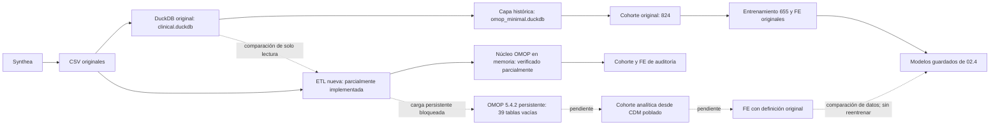
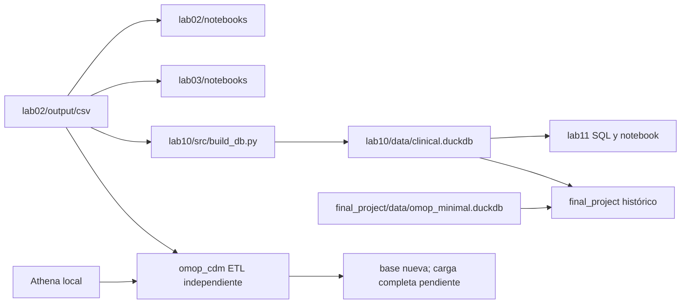

# Auditoría y organización del repositorio

## Flujo real y estado de la migración — revisión del 16 de noviembre



Las flechas históricas describen artefactos existentes; no se ejecutaron modelos
durante la migración. La ETL nueva lee CSV: la base DuckDB original aporta
controles y comparaciones de solo lectura, no se transforma en una fuente que
pueda sobrescribirse. La ruta completa desde la OMOP persistente poblada a la
cohorte y FE sigue pendiente. No se presenta la rama en memoria como persistencia.

Estado actualizado, bloqueo científico de 02.4 y procedimiento de almacenamiento:
[completion_status.md](../omop_cdm/docs/completion_status.md). No se añadieron nuevas
carpetas académicas ni se modificaron rutas de los notebooks en esta revisión.

Auditoría iniciada el 15 de noviembre de 2026 (hora de México). No se realizó
commit, push, merge, eliminación de datos ni limpieza de worktrees.

## Estado inicial y decisiones

La rama era `feat/final-project-features`, HEAD
`a65083c2349b42c50148da39172b21dfca39b4d9`. Ya existían modificaciones de README,
requirements y SQL de características del proyecto final, dos notebooks marcados
como eliminados en sus rutas rastreadas y versiones reubicadas sin rastrear.
Esos cambios no se revierten ni se atribuyen a esta reorganización. Véanse
[estado inicial](audit/git_status_before.txt), [archivos rastreados](audit/git_tracked_before.txt)
y [worktrees](audit/worktrees_before.txt).

Se leyeron `AGENTS.md`, los README de los laboratorios, configuración Git,
notebooks, SQL, constructor de Lab 10 y la implementación OMOP local anterior.
No había instrucciones adicionales en subdirectorios. La autorización del usuario
para reorganizar los laboratorios permite los cambios mínimos descritos aquí.

El disco raíz tenía aproximadamente **184 MiB disponibles**. Las fuentes CSV
ocupan varios GB; copiar vocabularios y eventos completos no era viable. Se
detuvo la carga persistente completa, sin borrar archivos para liberar espacio.
El código nuevo comprueba espacio antes de crear la salida.

`healthcare-lab12-omop-cdm/` es un worktree local limpio cuya entrada Git todavía
apunta a su antigua ubicación fuera del repositorio. No se repara automáticamente:
su repositorio interno, bases, resultados e historial son independientes. Se
preserva entero y se excluye del índice principal. No se copia su ETL como si
fuera una implementación completa: tenía alcance clínico limitado y suplementos
de vocabulario de procedencias distintas. La auditoría nueva utiliza las dos
descargas Athena originales directamente.

`FInal_proyect/` contiene un README vacío y subdirectorios vacíos locales. No se
renombra, fusiona ni elimina. Las carpetas de Athena tampoco se mueven.

## Árboles anterior y nuevo

Los inventarios recursivos están en [árbol anterior](audit/tree_before.txt) y
[árbol nuevo](audit/tree_after.txt); los manifiestos `files_before.json` y
`files_after.json` incluyen rutas y tamaños. Se recorren todas las carpetas de
proyecto, datos y worktree local. Solo se omite el interior de entornos, Git y
cachés, que se señala explícitamente. El árbol inicial se capturó antes de mover
archivos; ya incluye la propia herramienta de auditoría recién creada.

```text
Antes                              Después
lab02/analisis_pacientes.ipynb      lab02/notebooks/analisis_pacientes.ipynb
lab02/output/                      lab02/output/                  [preservado]
lab03/eda_cohorte.ipynb             lab03/notebooks/eda_cohorte.ipynb
lab03/figuras/                     lab03/figuras/                 [preservado]
lab04/{src,tests}/                 lab04/{src,tests}/             [preservado]
lab05/clinlab/                     lab05/clinlab/ + README.md
lab06/clinlab/                     lab06/clinlab/ + README.md
lab07/stack/                       lab07/stack/ + README.md
lab10/build_db.py                  lab10/src/build_db.py
                                  lab10/build_db.py              [entrada compatible nueva]
lab10/{data,sql,notebooks,docs}/    lab10/{data,sql,notebooks,docs}/
lab11/{sql,notebooks,docs}/         lab11/{sql,notebooks,docs}/
final_project/                    final_project/                 [notebooks/datos intactos]
                                  omop_cdm/{src,sql,tests,docs}/
                                  tools/audit_repository.py
                                  docs/audit/
```

Se mantiene la numeración original. `omop_cdm/` es una implementación transversal
independiente, no un cambio de nombre del Lab 12 del otro worktree. No se crean
carpetas vacías para uniformar visualmente proyectos que ya son reproducibles.

## Movimientos y conservación

Los tres movimientos rastreados anteriores se hicieron con `git mv`. Se
actualizaron las rutas de entrada/salida de los notebooks movidos, los README,
la ruta de implementación del constructor y el mensaje del notebook de Lab 10.
Las celdas de resultados y metadatos de los notebooks movidos se conservan.

La entrada histórica `lab10/build_db.py` delega en `src/build_db.py`. Ambas rutas
rechazan una base ya existente antes de abrirla, evitando el `DROP TABLE` del
constructor original. Esta tarea no ejecutó el constructor sobre la base local.

Los notebooks originales 02.3 y 02.4, todos los históricos del proyecto final,
entregables PDF y las dos bases originales quedan cubiertos por hashes SHA-256
en [protected_before.json](audit/protected_before.json). La verificación final
comprueba también que no se añadió ni quitó ningún notebook protegido.

Hay equivalencia SHA-256 demostrada entre las copias 02.1 y 02.2 y entre código,
pruebas y configuración de los paquetes de Lab 05 y Lab 06. Se conservan por su
función de entregas e instantáneas independientes. No se consolidó ni eliminó
ningún archivo. Los marcadores `.gitkeep`, cachés locales y directorios vacíos
preexistentes también se conservan. `lab02/activity8_measure.py`, sin rastrear,
mantiene su ubicación y funcionamiento desde `lab02/`.

## Dependencias y directorios de ejecución



| Unidad | Directorio de trabajo / contrato |
|---|---|
| Lab 02 notebook | `lab02/notebooks/`, entrada `../output/csv/` |
| Lab 03 notebook | `lab03/notebooks/`, entrada `../../lab02/output/csv/`, figuras `../figuras/` |
| Lab 04 | Importaciones como paquete `lab04`; conserva `src/` y `tests/` |
| Lab 05–06 | Cada paquete desde `labXX/clinlab/`; sus imports no se mezclan |
| Lab 07 | Compose desde `lab07/stack/`; montajes y `.env` intactos |
| Lab 10 constructor | Cualquier cwd: calcula la raíz de Lab 10 y fija allí el cwd SQL |
| Lab 10 notebook | Candidatas `../data/clinical.duckdb` y `lab10/data/clinical.duckdb` intactas |
| Lab 11 | Busca el repositorio por `lab10/data/clinical.duckdb` y abre solo lectura |
| Notebook 02.4 | Busca raíz por `final_project/notebooks/`; las dos rutas DuckDB siguen iguales |
| OMOP nuevo | CLI con rutas explícitas; no necesita importar código de otros laboratorios |

Las rutas absolutas del entorno `machine_learning_env` en documentación histórica
son particulares de esta máquina, no requisitos de la nueva ETL. Los notebooks
históricos movidos por el usuario antes de esta tarea pueden requerir ejecutar
desde la raíz para resolver rutas relativas antiguas; no se modifican para
mantener su integridad. La reproducción del nuevo flujo se documenta aparte.

`.gitignore` ahora cubre bases, WAL, Parquet, secretos `.env`, vocabularios,
resultados por paciente y los dos árboles locales protegidos. No se añadieron
datos ni archivos de vocabulario al índice. Los CSV no se ignoran globalmente
para permitir archivos de especificación y pruebas; las fuentes clínicas siguen
dentro de directorios explícitamente ignorados.

## Límites de esta entrega

La reorganización es conservadora y verificada. La migración persistente completa
permanece pendiente por espacio, vocabularios faltantes y ejecución DQD. El
[informe científico](../omop_cdm/docs/validation.md) distingue el esquema vacío
persistente de las tablas cargadas y validadas en memoria. No se sustituyen los
datos ni la definición del estudio para conseguir artificialmente igualdad.
