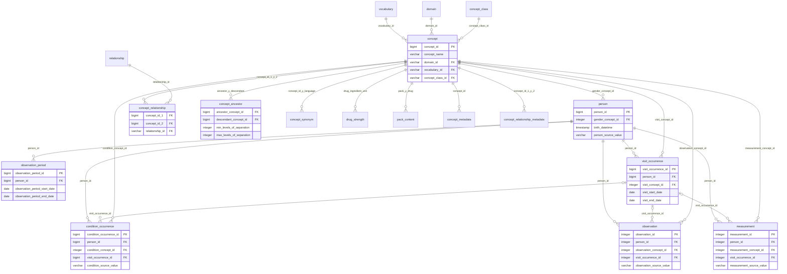
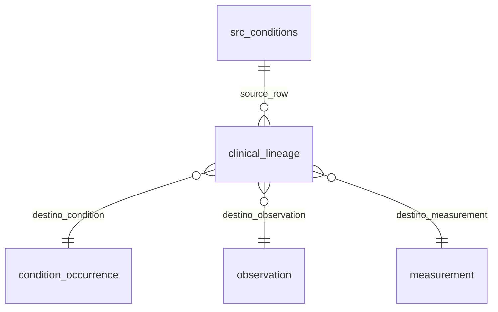

# ER final y contraste con OMOP CDM v5.4

Diagrama de las seis tablas clínicas y las doce tablas de vocabulario cargadas.
Se muestran llaves principales; las columnas completas se verifican en
comparacion_esquema.json contra el DDL oficial CommonDataModel v5.4.0.
Las llaves clínicas son **lógicas y auditadas**, no constraints físicos declarados
para todas las tablas. Concepto cero es la excepción reservada para dato sin mapeo.

Las claves de diccionarios son vocabulary_id, domain_id, concept_class_id y
relationship_id. CONCEPT_RELATIONSHIP tiene clave lógica compuesta
(concept_id_1, concept_id_2, relationship_id); CONCEPT_ANCESTOR,
(ancestor_concept_id, descendant_concept_id). La unión ATHENA verificó conflictos
para esas claves. Metadatos y sinónimos pueden tener varias filas por concepto.
Las referencias a conceptos de vocabulario/dominio/clase se auditan también.

## Trazabilidad adicional al CDM

Las tres flechas de destino son **alternativas** según event_table, no tres FKs
simultáneas. clinical_lineage registra source_row, event_table, event_id y
concepto destino. Se comprueba que cada traza tenga origen y destino correctos y
que ninguna fila fuente quede sin traza. rejected_domain conserva el archivo de
los 430935 destinos inicialmente separados: ya no son descartes pendientes.
Otras tablas de trabajo son src_patients, src_encounters, mapping, mapped,
condition_lineage, migration_relocated, visit_mapping_audit y lab12_run. No son
parte normativa del CDM y sus datos permanecen locales.

## Comparación y dos diferencias clasificadas

[Especificación oficial v5.4](https://ohdsi.github.io/CommonDataModel/cdm54.html).
La comparación ejecutada no encontró columnas faltantes ni adicionales en las
seis tablas clínicas, incluidas Observation y Measurement tomadas del DDL oficial.
Esto no demuestra igualdad de constraints o semántica de todas las columnas.

1. **Subconjunto de tablas y campos incompletos.** No se instancian todas las
   tablas del CDM, ni se convierten todos los CSV Synthea. Raza, etnia y algunos
   tipos/procedencia quedan en cero. El subconjunto es una simplificación docente
   legítima según la ruta manual del enunciado; no es conformidad completa ni
   suficiencia para una investigación clínica sin más trabajo.
2. **Constraints y observación aproximada.** Las llaves se verifican con consultas
   en lugar de declararse físicamente en todo el modelo; el período procede de
   primera/última visita. Es una decisión técnica explícita para la carga analítica,
   pero no certifica integridad automática futura ni cobertura asistencial continua.
   Su falta de fidelidad clínica sería un error si se presentara como seguimiento
   completo: por eso se cuantifican huecos y eventos externos.

PACK_CONTENT y las tablas *_METADATA vienen de la descarga moderna ATHENA y se
conservan como auxiliares, sin afirmar que sean tablas clínicas normativas 5.4.
La fila de diccionario denominada CDM v6.0.0 no convierte este esquema a CDM 6.
